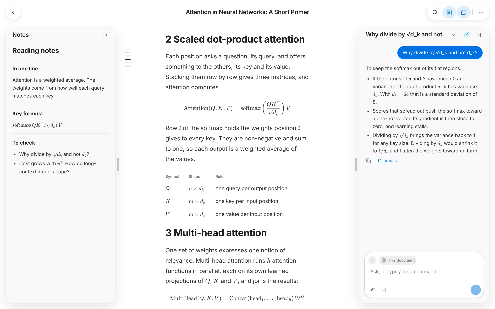

  

<h1 align="center">Ema Paper</h1>

  <strong>Turn PDFs and scans into text you can read, translate and ask about.</strong> 
  Upload a paper. Read it as clean text, with your notes and an AI agent beside it.

  <a href="https://ema-paper.yuufeng.com"><strong>Start free</strong></a>
  ·
  <a href="https://ema-paper.yuufeng.com/pricing">Pricing</a>
  ·
  <a href="./README.zh-TW.md">繁體中文</a>

<picture>
  <source media="(prefers-color-scheme: dark)" srcset="./docs/assets/reader-en-dark.webp" />
  
</picture>

## What you get

- **Clean text from every page**: columns, tables, formulas and scans, with each figure kept in place.
- **Translation under each paragraph**: one command, `/translate`.
- **An agent that sees the pages**: ask about a sentence, a section or the whole paper.
- **Notes beside the paper**: excerpts and section links that jump back to the source.
- **Every edit kept**: folders, a Trash, and a revision you can undo for every change.
- **Works with Claude**: add the MCP connector, or call the REST API.

## Pricing

**Free to start**, with credits every month. The model is included: no API key to bring, no card to enter. [See plans](https://ema-paper.yuufeng.com/pricing)

---

Run it yourself with the [self-hosting guide](./docs/self-hosting.md). MIT licensed.
