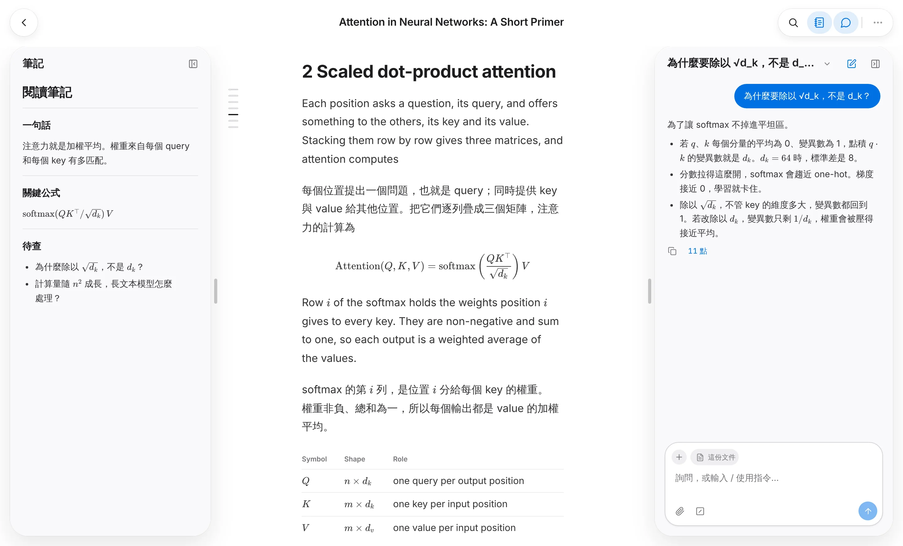

  

<h1 align="center">Ema Paper</h1>

  <strong>把 PDF 和掃描檔變成能讀、能翻譯、能提問的文字。</strong> 
  上傳一篇論文，就能讀乾淨的文字。筆記和 AI agent 就在旁邊。

  <a href="https://ema-paper.yuufeng.com/zh-TW"><strong>免費開始</strong></a>
  ·
  <a href="https://ema-paper.yuufeng.com/zh-TW/pricing">定價</a>
  ·
  <a href="./README.md">English</a>

<picture>
  <source media="(prefers-color-scheme: dark)" srcset="./docs/assets/reader-zh-dark.webp" />
  
</picture>

## 你會得到

- **每一頁都變成乾淨的文字**：多欄排版、表格、公式、掃描件都行，圖留在原位。
- **譯文接在每段下面**：一個指令 `/translate` 就好。
- **有問題直接問 agent**：它看得到原始頁面，問一句、一節或整篇都行。
- **筆記就在旁邊**：摘錄和章節連結，點一下跳回原文。
- **每次修改都留著**：資料夾、垃圾桶，每個改動都能復原。
- **接得上 Claude**：加入 MCP 連接器，或呼叫 REST API。

## 定價

**免費開始**，每月都有點數。模型費用已含在內，不用自備 API 金鑰，也不用綁卡。[看方案](https://ema-paper.yuufeng.com/zh-TW/pricing)

---

想自己架設，請看[自架指南](./docs/self-hosting.md)（英文）。MIT 授權。
